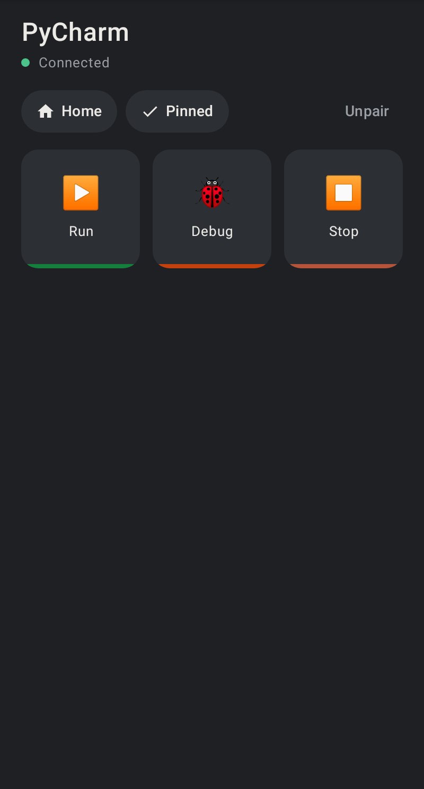
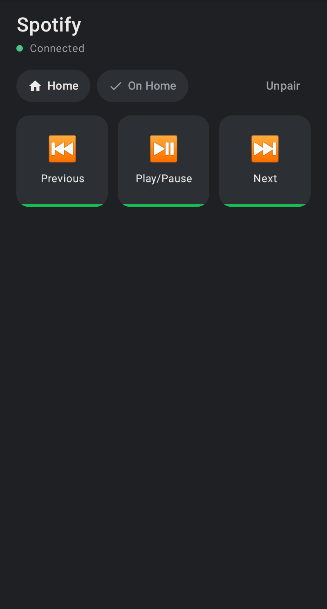
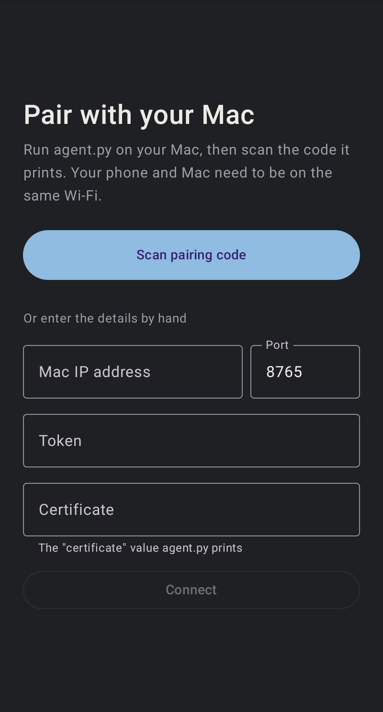

# MacDeck — an app-aware keypad for your Mac

Turn an Android phone into a Stream Deck–style keypad for your Mac. The phone
shows keys for **whichever app is in front** (PyCharm, VS Code, Chrome, Claude,
ChatGPT, Cursor, Spotify…), and tapping a key runs a shortcut, types text,
controls media, opens an app or runs a script.

<p>
  
  
  
</p>

- **Follows the Mac:** the keys change as soon as you switch apps.
- **Home keys:** your everyday keys, plus apps you **pin**. Rearrange them by dragging.
- **Wi-Fi or USB:** pair by scanning a QR code, or plug the phone in and run the agent with `--usb`.
- **Secure by default:** TLS with the Mac's certificate pinned from the QR code, plus a pairing token.
- **Real logos:** brand logos (CC0) or each app's own macOS icon on the keys.
- **Accessible:** TalkBack labels and actions, large-font layouts, 44 dp+ touch targets.

## Repository layout

```
macos-agent/    Python agent that runs on the Mac (watches the front app, runs actions)
android-app/    Android app (Kotlin + Jetpack Compose)
protocol/       Example of the phone ↔ Mac message format, checked by both sides' tests
.github/        CI (lint, tests, screenshots, release build) and Dependabot
```

## Requirements

- **Mac:** macOS 14 or later, Python 3.10+, and `openssl` (included with macOS).
- **Phone:** Android 8.0 (API 26) or later.
- **To build the app:** Android Studio, or JDK 17+ with the included Gradle wrapper.
- **For USB mode:** Android platform-tools (`adb`); Android Studio installs them.

## Quick start

### 1. Start the agent on your Mac

```bash
git clone https://github.com/fmoralesEnroute/deck_keypad.git
```
```bash
cd deck_keypad/macos-agent && python3 -m venv .venv && source .venv/bin/activate && pip install -r requirements.txt
```
```bash
python3 agent.py
```

The first time, macOS blocks the keystrokes. Open **System Settings → Privacy &
Security → Accessibility**, turn on the app you ran the agent from (Terminal,
iTerm, VS Code…), then restart the agent. If macOS asks whether Python may
accept incoming network connections, click **Allow**.

The agent prints a QR code, plus the address, port, token and certificate in
case you'd rather type them in.

### 2. Install the app and pair

Open `android-app/` in Android Studio and run it, or from the command line:

```bash
cd android-app && ./gradlew installDebug
```

Tap **Scan pairing code** and scan the QR code. Your phone and Mac need to be
on the same Wi-Fi. Switch apps on your Mac and watch the keys change.

### Or connect over USB

```bash
python3 agent.py --usb
```

Turn on USB debugging on the phone and plug it in:
- **No QR code or Wi-Fi:** the agent tunnels the phone's `localhost` to your Mac
  through the cable (`adb reverse`), opens MacDeck and hands it the pairing.
  Tap **Connect**; the agent prints the certificate ending, so you can check it
  matches what the phone shows.
- **Nothing on the network:** in this mode the agent listens only on
  `127.0.0.1`, so nothing else on your network can reach it.
- **Reconnects by itself:** replugging the phone, or adb restarting (Android
  Studio does this), restores the tunnel automatically.
- **Finding adb:** the agent looks on your `PATH`, in `$ANDROID_HOME`, and in
  Android Studio's SDK folder.

## Using it

### Home, pins and rearranging

- **Home:** while an app's own keys are showing, **Home** switches to your
  default keys, and **← App** switches back. Bringing another app to the front
  shows that app's keys again. Apps without keys of their own show Home directly.
- **Pin:** adds the current app to the Home keys, with its logo. Tapping it
  there brings the app to the front on your Mac. **Pinned** unpins it. Apps a
  default key already opens (like Spotify) show **On Home** instead, so they
  can't be added twice.
- **Rearrange:** on the Home keys, long-press any key (or tap **Edit**) and drag
  keys where you want them. Pinned apps show a **✕** to remove them. Tap
  **Done** when finished. With TalkBack, use a key's **Move earlier / Move
  later** actions instead of dragging.
- **Where it's saved:** on the Mac, in `macos-agent/pins.json` and
  `macos-agent/home_order.json`.

### Make it yours: `profiles.json`

Profiles are keyed by the app's bundle ID. The agent prints it each time you
switch apps (`Active app: Figma (com.figma.Desktop)`), and the phone shows it
when an app has no profile yet. Edits apply as soon as you save.

```json
"com.figma.Desktop": {
  "name": "Figma",
  "buttons": [
    { "label": "Frame", "icon": "#", "color": "#A259FF",
      "action": { "kind": "hotkey", "keys": ["f"] } }
  ]
}
```

The shipped profiles cover PyCharm, VS Code, Chrome, Safari, Finder, Slack,
Zoom, Spotify, Claude, ChatGPT and Cursor. Claude's and ChatGPT's shortcuts
were read from the apps themselves; Cursor's are its documented defaults.

- **`"default"`:** the Home keys.
- **Default key names:** a default key can have a `"key"` (a unique name), so
  your saved Home order survives renaming it.
- **`"ignore_apps"`:** apps that never change the keys. It ships with Android
  Studio, so clicking a phone mirrored there doesn't swap the keys.

### Icons

A key's `"icon"` can be an emoji, or:

- **`"logo:spotify-icon"`:** a brand logo from `macos-agent/logos/`. These come
  from [SVG Logos](https://github.com/gilbarbara/logos) (CC0; the set
  [Streamline](https://www.streamlinehq.com/icons/svg-logos) hosts). To add one,
  download `https://cdn.jsdelivr.net/gh/gilbarbara/logos/logos/<name>.svg` into
  `logos/`. Very dark logos (like OpenAI's) get a white tile so they're visible.
- **`"app:com.spotify.client"`:** the app's own macOS icon, by bundle ID or name.

A profile's `"logo"` is used for that app's key when it's pinned.

### Action kinds

| kind          | fields                      | example |
|---------------|-----------------------------|---------|
| `hotkey`      | `keys`                      | `["cmd","shift","p"]` |
| `text`        | `text`                      | `"git status\n"` |
| `open_app`    | `app`                       | `"Spotify"` |
| `open_url`    | `url`                       | `"https://github.com"` |
| `shell`       | `cmd`                       | `"say hello"` |
| `applescript` | `script`                    | `"tell application \"Music\" to playpause"` |
| `media`       | `key`                       | `"play_pause"`, `"next"`, `"previous"`, `"volume_up"`, `"volume_down"`, `"mute"` |
| `delay`       | `ms`                        | `300` |
| `sequence`    | `steps` (a list of actions) | see the VS Code "git status" key |

Modifiers: `cmd`, `shift`, `ctrl`, `alt`/`opt`. Keys: letters, digits,
punctuation, `f1`–`f12`, `up/down/left/right`, `return`, `tab`, `space`,
`escape`, `delete`, `home`, `end`, `pageup`, `pagedown`.

`media` presses the Mac's media keys, so it controls whatever is playing and
needs no extra permission. `applescript` also needs **Automation** permission
(Privacy & Security → Automation) for your terminal to control the target app.

## Troubleshooting

**"Can't reach your Mac".** The phone and Mac must be on the same Wi-Fi, and the
address the phone saved must be the Mac's Wi-Fi address, which the agent prints.
The agent ignores VPN addresses automatically; set `MACDECK_HOST` to override
it. Otherwise unpair and scan again, or use `--usb`.

**A key does nothing.** Look at the agent's terminal. Every press prints
`Press: <label> -> <kind>`, and a failure prints `Action failed:` with the reason.

- **"macOS is blocking keystrokes":** turn on your terminal app under Privacy &
  Security → **Accessibility**, then restart the agent. If it's already on,
  toggle it off and on; macOS can keep a stale entry after a Python update.
- **"macOS blocked the AppleScript":** allow your terminal under Privacy &
  Security → **Automation**. If it isn't listed, run
  `tccutil reset AppleEvents com.googlecode.iterm2` (with your terminal's
  bundle ID) and press the key again to get the prompt.

**"agent.py is out of date".** The agent on the Mac doesn't announce a feature
the app uses (Home, pins, rearranging or images). Update `macos-agent/` and
restart it. After that, the agent restarts itself whenever its code changes
(only if everything compiles), and `profiles.json` reloads on save.

## How it works

```
Mac app comes to front ──▶ agent (NSWorkspace notification)
                            │  looks up profiles.json
                            ▼
                   {"type":"layout", ...}  ──▶  phone redraws the keys
phone tap ──▶ {"type":"press","id":"3","app":"com.jetbrains.pycharm"}
                            │
                            ▼
              agent posts the keystroke with CGEvent
```

- **Presses carry their app:** each press includes the app whose keys were on
  screen, so a tap made while you switch windows never fires a key from the
  wrong app.
- **Icons are sent once:** layouts refer to icons by hash, and each phone
  receives an icon's bytes only once per connection.
- **Features are announced:** each layout lists what the agent supports.
- **The format is shared:** [`protocol/layout-example.json`](protocol/layout-example.json)
  is a real message, checked by the tests on both sides.

### Security

- **Encrypted, pinned connection:** the connection is TLS (`wss://`). On first
  run the agent creates a self-signed certificate (`.cert.pem` / `.key.pem`) and
  puts its SHA-256 fingerprint in the QR code. The phone trusts that certificate
  and nothing else, so someone on the same Wi-Fi can neither read the pairing
  token nor pose as your Mac.
- **Token required:** every connection must start with the pairing token, which
  lives in `macos-agent/.token`. Delete it to un-pair every phone. Delete the
  `.pem` files to rotate the certificate; phones then need to pair again.
- **Stays on the phone:** the pairing is excluded from Android backups and
  device-to-device transfer.
- **Not in git:** the token, certificate and key are all git-ignored.

## Development

```bash
cd android-app
./gradlew testDebugUnitTest      # unit, TLS WebSocket integration and Compose UI tests
./gradlew lintDebug              # security/accessibility lint checks fail the build
./gradlew verifyRoborazziDebug   # compare screenshots with src/test/snapshots
./gradlew recordRoborazziDebug   # re-record them after an intended UI change
./gradlew assembleRelease        # R8-minified release build
```

Agent tests, from `macos-agent/` in the virtualenv:

```bash
pip install -r requirements-dev.txt && python -m pytest tests
```

After an intended change to the message format, regenerate the shared example
with `UPDATE_PROTOCOL=1 python -m pytest tests/test_protocol.py`.

```
macos-agent/
  agent.py              entry point: arguments, startup, frontmost-app watcher
  profiles.json         keys per app
  logos/                bundled CC0 brand logos (SVG)
  macdeck_agent/
    actions.py          hotkeys, text, media keys, apps, AppleScript
    icons.py            logos and app icons, sent to each phone once by hash
    home.py             profiles, Home keys, pins, order, layout messages
    server.py           the WebSocket server
    pairing.py          token, TLS certificate, QR code, Wi-Fi address
    usb.py              --usb: adb tunnel (repaired if adb restarts), pairing
    reload.py           restart when the agent's code changes
    config.py, store.py paths and features; safe JSON writes
  tests/                pytest suite

android-app/app/src/main/java/com/example/macdeck/
  Pairing.kt            pairing data, QR parsing and validation
  DeckProtocol.kt       wire format (pure Kotlin, JVM-testable)
  DeckTransport.kt      OkHttp WebSocket as a Flow, certificate pinning
  PairingStore.kt       persistence
  NetworkMonitor.kt     reconnect immediately when the network changes
  DeckViewModel.kt      connection lifecycle and UI state
  DeckScreenModel.kt    what the deck screen shows (pure, unit-tested)
  MacDeckApp.kt         root composable, USB pairing dialog
  DeckScreen.kt         header (Home · Pin · Edit · Unpair), notices
  KeyGrid.kt            keys, drag-to-rearrange
  PairScreen.kt         pairing screen
  Theme.kt              colors and theme
```

CI ([`.github/workflows/ci.yml`](.github/workflows/ci.yml)) runs on every push
and pull request:
- **Android:** lint, the unit and UI tests, and a release build.
- **Screenshots:** compared on macOS, where the reference images are recorded.
- **Agent:** the pytest suite, on macOS.

Dependabot keeps the dependencies up to date.

## Ideas for next steps

- Multiple pages per profile
- A menu-bar app (rumps or a Swift wrapper) instead of a terminal window
- A visual profile editor on the phone that writes back to the agent
- Auto-discovery with Bonjour (zeroconf on the Mac, NsdManager on Android)
- A release signing config and a real application ID for distribution

## Credits

Brand logos in `macos-agent/logos/` are from [SVG Logos](https://github.com/gilbarbara/logos)
by Gil Barbara, released under CC0 ([license](macos-agent/logos/LICENSE.txt)).
Logos are trademarks of their respective owners.
